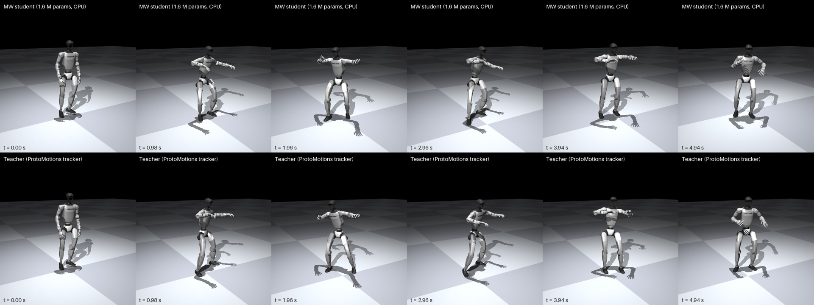

# MW Robotics (MW: Modak-Walawalkar)

**Distill a robot policy trained by a large lab into a small Bayesian policy that runs on an ordinary CPU and reports, every step,
how sure it is, so a fallback can take over before a mistake.**

| | What it is | Status |
|---|---|---|
| **Part 1: policy distillation, powered by Bayesian methods** ([`for_distilation/`](for_distilation/)) | A teacher policy whose licence allows derivative models (here NVIDIA ProtoMotions' Unitree G1 tracker) distilled into a 7.7 MB MW policy for CPU and edge devices | **Working in simulation** on the G1. Details and intervals below |
| **Part 2: policy generation** ([`ROADMAP.md`](ROADMAP.md)) | Physics-fortified policies trained from the start with priors, a manifold of accepted states and built-in uncertainty | **Research plan, not yet a result** |

[](for_distilation/protomotions_g1/results/video/mw_vs_teacher_dance.mp4)

*MW policy vs NVIDIA's teacher on a dance clip the policy never saw (MuJoCo; [video](for_distilation/protomotions_g1/results/video/mw_vs_teacher_dance.mp4), versioned in git, SHA-256 in [EVIDENCE.md](for_distilation/protomotions_g1/results/EVIDENCE.md)).*

## Part 1 in one picture

```
 teacher policy (licence allows       drive the robot in simulation,        MW policy, 7.7 MB          any CPU: laptop,
 derivative models), e.g. NVIDIA ───► record (what it sees, what it   ───►  state manifold      ───►  robot computer,
 ProtoMotions' G1 tracker             does) on a few hundred motions        + Bayesian action          edge device
                                                                            head                        │
                                                                    action + "how sure am I?"  ───►  warning / safe fallback
```

## What we measured (Unitree G1, MuJoCo, ProtoMotions' own evaluator)

Teacher: NVIDIA ProtoMotions' G1 whole-body tracker (`g1-bones-deploy`). Training data: the teacher driving the robot on 4 original
motions plus **324 distinct motions generated with NVIDIA's open Kimodo text-to-motion model** (walking, gestures, exercise, everyday
actions; **no dance**). We prepared 500; the rollouts picked motions at random and reached 324.
Exam: an unseen dance clip, run clean once and with action noise 0.1 and 0.2 (3 seeds each), 7 runs per policy.

| Policy | Dance clip, 7 runs (95 % interval) | 21 unseen familiar motions | 30 unseen generated dances | Fall warning (AUROC, 95 % interval) |
|---|---|---|---|---|
| Plain MLP | 6/7 (0.49–0.97) | 18/21 | 26/30 | none of its own |
| MW level 1: Bayesian action head | 5/7 (0.36–0.92) | 19/21 | 27/30 | 0.992 (0.978–1.000) |
| **MW level 2: state manifold + Bayesian action head** | **7/7 (0.65–1.00)** | **20/21** | 24/30 | **0.996 (0.992–0.999)** |
| MW student, 100 motions (alone) | 3/7 (0.16–0.75) | 17/21 | 20/30 | 0.994 (0.989–0.998) |
| **Same 100-motion student + MW fly-by-wire (envelope D)** | **7/7 (0.65–1.00)** | **21/21** | **30/30** | – (no falls left to warn about) |
| Teacher (NVIDIA) | 7/7 | 21/21 | 30/30 | – |

**Fly-by-wire (new, 2026-11-08):** the 100-motion student, not retrained, plus a physics flight computer completed **58 of 58** tests,
matching NVIDIA's teacher (alone: 40/58). The flight computer holds an exact MuJoCo model of the robot, looks 0.4 s ahead with the
student in the loop, and steps in only when the predicted capture point or torso leaves the balance envelope. Cost: +3.8 % median
joint-tracking error. Simulation only, one student, and not yet real time on CPU. Code, how envelope D was designed and how to
design one for another policy: [`fly_by_wire/`](fly_by_wire/README.md).

**How to read this, honestly:**

* **Task performance: MW level 2 matches the teacher on the unseen dance; with 7 runs it is not shown to beat the plain MLP.** The
  intervals overlap. On the 30 unseen generated dances the plain MLP completed more (26 vs 24).
* **The warning is the solid result.** Fall = ProtoMotions' own failure rule (pelvis height more than 0.25 m off the reference).
  The AUROC counts a step as positive if a failure follows within 0.5 s. It rests on few failures, so we report them: 6 failed
  episodes behind the 0.996, and **26 failures across three separately trained students, every one of them warned 0.16 to 0.96 s in
  advance**, with 2–3 false alarms per 5–6 minutes of normal running at the threshold we used. Details, per-run results and the
  threshold method (in-sample so far): [EVIDENCE.md](for_distilation/protomotions_g1/results/EVIDENCE.md).
* **Level 1 vs level 2 (our most interesting finding).** The Bayesian head alone (level 1) warns just as well as level 2: the
  difference in AUROC is within the intervals. But on its own it tracked the dance *worse* than the plain MLP. Adding the state
  manifold (level 2) is what restored task performance. **Uncertainty and competence came from different parts of the model**:
  the Bayesian head knows when it is lost; the manifold keeps it from getting lost.
* **Data coverage mattered more than anything else** (same exam, MW policy): no extra motions 0/9 runs; 100 random motions 1/9;
  100 motions chosen evenly across the four kinds 3/7; 324 motions 7/7.
* **Size and speed:** 1.65 M parameters, 7.7 MB, **2.3 ms per control step on one thread of a laptop CPU** (Intel i5-12450H),
  uncertainty included; the robot needs a decision every 20 ms. Phone-class CPUs should manage this on paper; not yet tested on a
  phone (ONNX export is the next packaging step).

The student does not outgrow its teacher here; it copies it into a form that is cheap to run and reports its own uncertainty.
Outgrowing a teacher with physics priors is shown so far only on a pendulum
([docs/BEYOND_THE_TEACHER.md](docs/BEYOND_THE_TEACHER.md)).

## Verify it

* **In minutes, any CPU:** `python for_distilation/protomotions_g1/examples/policy_priors_demo.py 0,1,2,3,4` prints
  `plain 18 | prior 0` (falls in 35 push tests; re-run 2026-11-07). `pytest -q`: 17 of 20 tests pass; the 3 failures are small
  stochastic checks in the older detector and transition-gate code, not the Part 1 code.
* **The G1 result:** needs ProtoMotions, MuJoCo, NVIDIA's checkpoint and Kimodo; a gaming laptop is enough, but it is a day's setup,
  not an afternoon's. We ship no weights (they derive from NVIDIA's model); the scripts regenerate everything:
  [`for_distilation/protomotions_g1/`](for_distilation/protomotions_g1/README.md#reproduce).

## Which teacher policies you may use

Only policies whose licence allows it. Distillation creates a model *derived* from the teacher, so check: the **teacher's licence**
allows derivative models (and commercial use, if you need it; NVIDIA's G1 tracker is under the NVIDIA Open Model License, which
allows both, with an attribution notice when you redistribute); the licences of the **motions** and of any **text encoder** used to
generate them; and the **attribution** you must ship. Step by step: [`docs/POLICY_TO_PRODUCTION.md`](docs/POLICY_TO_PRODUCTION.md).

## Two kinds of students

* **Plain MLP:** an ordinary network fitted to the teacher's actions. No uncertainty of its own.
* **MW, by level:** level 1 = Bayesian action head (exact posterior over the last layer); level 2 = state manifold + Bayesian action
  head (the policy above); level 3 (in progress) = level 2 + physics priors on the consequences of each action. A first G1 attempt
  at level 3 made the policy worse (details in [docs/BEYOND_THE_TEACHER.md](docs/BEYOND_THE_TEACHER.md)).

In plain words, how a policy becomes a manifold: [`docs/HOW_IT_WORKS.md`](docs/HOW_IT_WORKS.md).

## What MW is, and how this connects to the rest of the framework

MW (Modak-Walawalkar) is one recipe applied to different systems: **write the physics you know as Bayesian priors, learn a
low-dimensional manifold of the states that satisfy them, and use the distance to that manifold as a built-in "this is unusual"
signal.** The system can be a PDE (in this repository: a flexible-link beam and five other small robot-physics examples, each with
its own learned manifold, [`docs/ROBOTICS.md`](docs/ROBOTICS.md)) or, as in Part 1, a robot policy, where the manifold is the set of
normal body states and the action is read from a point on it. The core library is [`mw_framework/`](mw_framework/) (Pyro).

Background papers by the authors (preprints on Zenodo, not peer reviewed):

* R. Modak, R. Walawalkar, *A Student-t(ν = 0.8) Prior on Measurement Processes Yields a Riemannian Manifold Simultaneously
  Consistent with General Relativity and Quantum Mechanics* (2026), [doi:10.5281/zenodo.19304813](https://doi.org/10.5281/zenodo.19304813): the MW
  prior-to-manifold construction applied to quantum gravity.
* R. Modak, R. Walawalkar, *World Models with an Irreversible Time Axis* (2026),
  [doi:10.5281/zenodo.22954118](https://doi.org/10.5281/zenodo.22954118): MW as a world model with a forward-only time axis; not
  yet applied to the robotics code here.
* Framework code and non-robotics examples: [MW_Geometric_Intelligence](https://github.com/RahulModak74/MW_Geometric_Intelligence).

## Part 2 (plan, not yet a result)

Distillation needs a teacher. Part 2 aims to make the teachers themselves sturdier: exact physics as priors, a manifold of accepted
(balanced, recoverable) states, look-ahead that keeps a trajectory on it, and uncertainty from day one, plugged into existing
GPU training pipelines rather than replacing them. Status and pieces: [`ROADMAP.md`](ROADMAP.md).

## Quick start

```bash
git clone https://github.com/RahulModak74/MW_Robotics.git && cd MW_Robotics
python -m venv .venv && . .venv/bin/activate            # Windows: .venv\Scripts\activate
pip install -e . && pip install -r for_distilation/requirements.txt
python for_distilation/protomotions_g1/examples/policy_priors_demo.py 0,1,2,3,4
pytest -q
```

A consumer NVIDIA GPU speeds up training (install a CUDA build of PyTorch first); everything also runs on CPU.

## Repository map

```
fly_by_wire/              the physics flight computer (envelope D, 58/58): code, design notes, results      <- new
for_distilation/          Part 1
  protomotions_g1/        the G1 result: code, results (EVIDENCE.md), video          <- start here
  *.py, app_3d.py         an earlier, self-contained distillation sandbox (MuJoCo Humanoid-v5, PPO teacher), 3D viewer
for_full_replacement/     Part 2 building blocks (validators, early warning, classical fallbacks, transition models)
mw_framework/             MW core library (physics-constrained Bayesian VAE, Pyro SVI)
docs/                     how it works, policy to production, beyond the teacher, six physics examples, limitations
examples/ tests/          the six small physics examples (one manifold each) and tests
mujoco_experiments/       the hopping-leg example checked against MuJoCo as a validator and a forecaster
```

## Why we build it this way

We use whatever compute is easily available, including the consumer GPUs that most teams in the Global South already own; our
stance on GPUs is pragmatic, not dogmatic. What we want to remove are barriers to *running* robots (closed runtimes, licence
servers, hardware only a few can buy), not any technology. Collaboration on Part 2 is welcome: see [`ROADMAP.md`](ROADMAP.md).

## Join in

Reproductions (successful or not), new teacher policies with licences that allow it, new robots and honest failures:
[`CONTRIBUTING.md`](CONTRIBUTING.md). Research code; simulation results only; not a safety system. Apache-2.0 ([`LICENSE`](LICENSE));
please cite [`CITATION.cff`](CITATION.cff).
