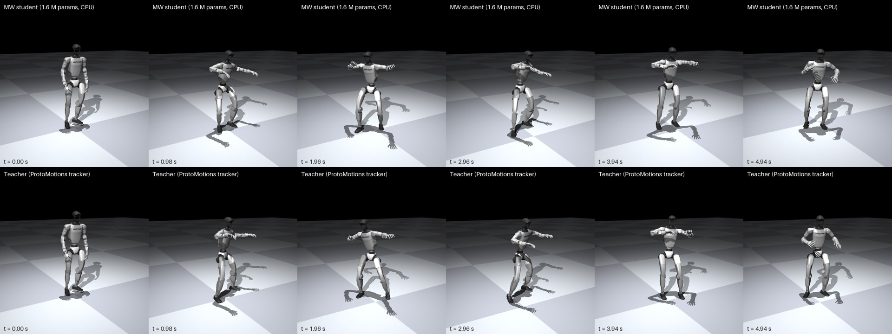

# Unitree G1: an MW policy distilled from NVIDIA ProtoMotions dances a clip it never saw

**Part 1 of MW Robotics, ready.** A 1.65-million-parameter MW policy (7.7 MB, CPU) distilled from NVIDIA ProtoMotions' G1 whole-body
motion tracker (`g1-bones-deploy`, trained by NVIDIA with reinforcement learning on the BONES-SEED corpus). The exam is a **dance
clip the student never saw**: not one dance motion is in its training data. Everything runs in MuJoCo and is scored by
**ProtoMotions' own evaluator**.



Video: [`results/video/mw_vs_teacher_dance.mp4`](results/video/mw_vs_teacher_dance.mp4) (MW policy left, teacher right, 5 s).

## Result

Training data: the teacher driving the robot on the 4 original ProtoMotions motions (walk, wave, high-five, jumping jacks) plus
**324 distinct motions generated with NVIDIA's open Kimodo text-to-motion model**, from 500 prepared (125 each of locomotion,
gestures, exercise and everyday actions; all dance prompts held out). The teacher's rollouts picked motions at random, so they
reached 324 of the 500; a run that visits all 500 (`PM_ORDER=1` in `ours/pm_collect.py`) is under way. The dance clip is run clean once and with random action noise 0.1 and 0.2 (3 seeds each):
7 independent runs per policy.

| Policy | Dance clip (7 runs) | under heavy noise (0.2) | 21 unseen familiar motions | 30 unseen generated dances |
|---|---|---|---|---|
| Plain MLP | 6/7 | 2/3 | 18/21 | 26/30 |
| MW level 1 (Bayesian action head: last-layer Laplace) | 5/7 | 1/3 | 19/21 | 27/30 |
| **MW level 2 (state manifold + Bayesian action head)** | **7/7** | **3/3** | **20/21** | 24/30 |
| Teacher | 7/7 | 3/3 | 21/21 | 30/30 |

* **Only MW level 2 never fell on the dance clip**, including every heavy-noise run, and it tracked the dance most closely (worst
  joint error 0.25 rad vs about 0.40; position error 0.13 m vs 0.27 m).
* **It warns before it fails.** Its Bayesian uncertainty predicts that the evaluator will record a failure within the next 25 steps
  (0.5 s) with **AUROC 0.996** on the unseen dances and **0.997** on the unseen familiar motions. The plain MLP has no such signal;
  a generic novelty score on the observation (Mahalanobis distance) reaches 0.935.
* **Small and fast:** 2.3 ms per control step on one thread of a laptop CPU (Intel i5-12450H), uncertainty included; the control
  budget is 20 ms.
* **Open:** on the wider set of 30 unseen generated dances MW level 2 completes 24, fewer than the plain MLP (26). More motions and
  physics priors are the next levers.

This is distillation: the student learns from a teacher that already learned from a large motion corpus. The claim is that a
small CPU policy can take on the skill from a few hundred motions, robustly, and with a reliable "I am about to fail" signal.

### How much data it takes

| Training motions (besides the 4 originals) | MW on the dance clip | Table |
|---|---|---|
| none | 0/9 runs | [`results/SUMMARY_dance_s0.md`](results/SUMMARY_dance_s0.md) |
| 100, drawn at random | 1/9 | [`results/SUMMARY_quick100.md`](results/SUMMARY_quick100.md) |
| 100, chosen evenly (25 per kind of motion) | 3/7 | [`results/SUMMARY_s100_priors.md`](results/SUMMARY_s100_priors.md) (control arm) |
| **324, from 500 chosen evenly** | **7/7** | [`results/SUMMARY_m500.md`](results/SUMMARY_m500.md) |

Variety and coverage matter: 100 motions spread evenly beat 100 random ones, and 324 complete the picture.

## What the MW policy is

Plain-words version: [`../../docs/HOW_IT_WORKS.md`](../../docs/HOW_IT_WORKS.md).

* **State manifold:** an encoder maps the 349-number observation to a 16-dimensional latent and a decoder rebuilds the observation.
  How well it can be rebuilt is the **MW distance** (how far a situation is from the learned manifold of normal body states).
* **Action head on [observation, latent]:** the action is read from the situation *and* its place on the manifold (a skip path keeps
  precision).
* **Last-layer Laplace:** an exact Bayesian posterior over the final layer (closed form, one pass) gives the uncertainty that warns
  before falls.
* Trained with a conditional ELBO (Pyro SVI), accuracy first. Code: `ours/student_prob.py` (`MWBundleV2`, `LastLayer`),
  `ours/train_student_prob.py --kind mwv2 --lastlayer`.

## MW level 3: physics priors (in progress)

`ours/priors.py` and `ours/g1_kin.py` (differentiable G1 kinematics, matches MuJoCo to 3e-9 m) define laws that hold for any motion,
checked on the predicted next state: capture-point balance, upright torso, joint limits, follow the reference. Tolerances are the
teacher's own range. `ours/train_student_priors.py` (MW v3) enforces them on the consequences of the student's own actions, up to 10
steps ahead, including on states the teacher never visited.

* **Why it can help:** the pendulum demo [`examples/policy_priors_demo.py`](examples/policy_priors_demo.py): under hard pushes a plain
  student falls 18/35 times, a student with one physics law 0/35, and with a soft teacher the prior student even beats its teacher
  ([`../../docs/BEYOND_THE_TEACHER.md`](../../docs/BEYOND_THE_TEACHER.md)).
* **What we measured on the G1** (100 motions chosen evenly, `kimodo_data/s100_priors.sh`): a strong prior (λ = 140) made the
  policy *worse* than the identical control (dance 0/7 vs 3/7). In this version the consequences of an action are predicted by a
  small learned dynamics model, and pushing hard on an inaccurate prediction misleads the policy. The next version judges the laws
  with the robot's exact equations of motion. Results will be added when they pass.

## Reproduce

Needs a ProtoMotions clone with its MuJoCo dependencies and the `g1-bones-deploy` checkpoint (`PM=~/ProtoMotions` by default; see
`scripts/common.sh`), Kimodo (`~/kimodo`, for generating motions) and PyTorch + Pyro (a consumer GPU speeds up training; everything
runs on CPU).

```bash
# 1. generate motions (Kimodo; the Llama-3-8B text encoder is loaded in 4-bit)
cd kimodo_data && ~/kimodo/venv/bin/python encode_prompts.py --prompts prompts.json --out emb/ \
   && ~/kimodo/venv/bin/python gen_motions.py --prompts prompts.json --emb emb/ --out csv/
# 2. select 500 training motions (set PM_ORDER=1 so the teacher visits all of them), convert, collect teacher rollouts, train the students, evaluate, summarise
./m500.sh                        # stages: select convert collect train eval agg (each waits for CPU/memory < 70 %)
# 3. optional: 100 evenly chosen motions, priors vs control (reuses the m500 rollouts)
./s100_priors.sh
# 4. video of any run
#    pm_eval_student.py ... --qpos-out run.npz ; python ../scripts/render_dance.py out.mp4 "MW=run.npz" "Teacher=teacher.npz"
```

`ours/pm_eval_student.py` wraps ProtoMotions' evaluator: `--student`, `--act-noise`, `--seed`, `--uq-out` (per-step uncertainty),
`--gate S:T` (hand a step to the teacher when signal S exceeds T), `--qpos-out` (for videos). `render_dance.py` needs the real G1
meshes (ProtoMotions' are Git-LFS pointers; set `G1_MESHES`). To take another policy through the same steps:
[`../../docs/POLICY_TO_PRODUCTION.md`](../../docs/POLICY_TO_PRODUCTION.md).

## Licences and what is not here

Our code: the repository's licence (Apache-2.0). **Not included:** NVIDIA's tracker weights, the generated motions, teacher rollouts
and our trained policy weights (derived from the NVIDIA tracker; regenerate them with the scripts). ProtoMotions' code is Apache-2.0;
the tracker and Kimodo weights are under the NVIDIA Open Model License, which permits derivative models, including commercially,
with an attribution notice when you redistribute them; Kimodo's text encoder uses Llama 3 (Meta licence). Simulation only; not a
real-robot result.
