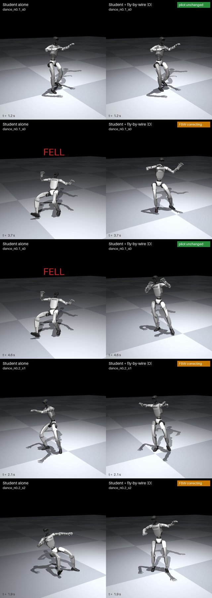

# MW fly-by-wire: a physics flight computer for a small CPU student

**Result (MuJoCo simulation, ProtoMotions' own evaluator):** an 8 MB MW student, not retrained, plus this flight computer completed
**58 of 58** tests, as NVIDIA's teacher does. Alone, the same student completes 40/58.

[](results/video/fbw_D_dance_rescues.mp4)

*The four dance-clip runs the student fails alone (action noise 0.1 / 0.2), left: alone, right: + fly-by-wire D. The badge shows
per step whether the flight computer passed the pilot's command through or corrected it. [Video](results/video/fbw_D_dance_rescues.mp4)
(20 s, SHA-256 c3db136e27023cbc50128a9155e674bf2573ed6ad0d946a5808e6909cf53f2b0).*

| Unitree G1, same student and seeds | Dance clip, 7 runs (95 % interval) | 21 unseen familiar motions | 30 unseen generated dances | All |
|---|---|---|---|---|
| MW student (100 motions), alone | 3/7 (0.16–0.75) | 17/21 | 20/30 | 40/58 |
| + fly-by-wire A: predicted falls only | 5/7 | 18/21 | 24/30 | 47/58 |
| **+ fly-by-wire D: full envelope** | **7/7 (0.65–1.00)** | **21/21** | **30/30** | **58/58** |
| Teacher (NVIDIA) | 7/7 | 21/21 | 30/30 | 58/58 |

* **Paired per test:** 18 rescued, 0 regressions (no test that passed alone failed with FBW), 0 falls left.
* **The model is exact:** the flight computer's one-step prediction of the robot matched the simulator to at most 1e-7 on every run.
* **The cost:** on the 40 tests that pass both ways, joint-tracking error rises by a median of 3.8 % (worst +23 %). D steers on
  about 20 % of steps. It trades a little tracking for balance.
* **Limits, stated plainly:** simulation only; one student; one run per motion library. The model is the simulator itself, and
  the flight computer reads the true state. It runs on CPU but **not yet in real time**: about 0.16 s per step when it lets the pilot
  through and about 3 s when it corrects, against a 20 ms control step. Next: real-time CPU, other students, stronger disturbances,
  a deliberately degraded robot with an inexact model, then hardware.

Per-run numbers: [`results/SUMMARY_fbw_runs.md`](results/SUMMARY_fbw_runs.md); tracking cost per test:
[`results/SUMMARY_fbw_tracking_r7c_D.md`](results/SUMMARY_fbw_tracking_r7c_D.md).

## How it works

Aircraft fly-by-wire: the pilot states intent, and a flight computer with an exact model of the airframe keeps the aircraft inside
its flight envelope. Here:

```
 student (pilot) ── joint targets ──► flight computer ── same targets (usually) ──► robot
                                       │  or the smallest correction that
                                       │  keeps the predicted states in the envelope
                                       └─ exact MuJoCo copy of the robot, 0.4 s look-ahead, the student reacting inside it
```

Every control step ([`fbw.py`](fbw.py)):

1. **Predict the pilot's plan.** Copy the robot's full state into a private MuJoCo model and simulate 20 control steps (0.4 s). At
   each predicted state the student is asked again what it would do, so the prediction includes its own reactions.
2. **Score it against the envelope.** Sum the law violations over the predicted states (laws below).
3. **Hands off if it stays inside.** If the cost is at most `quiet`, the student's command goes to the robot unchanged.
4. **Otherwise correct, minimally.** Roll out 63 smooth corrections (pilot + correction, the pilot still in the loop) under the known
   actuator-noise level, and send the pilot's command plus a blend of the best few. Deviation from the pilot is penalised, so the
   flight computer overrules it only as much as needed.

## Envelope D, and designing one for another robot

D = predicted fall + capture point within 5 cm of the support + torso within 50°, chosen by ablation (fall only 5/7, + upright 4/7,
+ capture point 7/7) and then accepted on 51 held-out motions with zero regressions. **The capture point is the law that matters.**
The full design story, and a step-by-step guide for other policies and robots: [`docs/DESIGNING_THE_ENVELOPE.md`](../../docs/DESIGNING_THE_ENVELOPE.md).

## Reproduce

Needs the setup of [`../student/`](../student/README.md#reproduce): ProtoMotions with
MuJoCo, the `g1-bones-deploy` checkpoint, the generated motions, and the 100-motion student from `kimodo_data/s100_priors.sh`
(`r7c_mwv3ctl_s100.pt`).

```bash
./run_fbw_D.sh <path>/r7c_mwv3ctl_s100.pt r7c          # 58 tests, one at a time; about 6 h on a laptop CPU (6 threads)
python fbw_tracking.py --alone <student-alone runs> --alone_arm r7c_mwv3ctl-s100 --fbw results_runs --fbw_arm fbwD_r7c --out tracking.md
```

`pm_eval_student.py --fbw` turns the flight computer on; every setting is an `FBW_*` environment variable (see `CFG` in `fbw.py`
and `run_fbw_D.sh`). Each run writes `<tag>_fbw.npz`: per step, whether FBW corrected, the pilot's predicted cost split by law, the
predicted fall probability, and the prior's one-step error. Videos: `pm_eval_student.py ... --qpos-out run.npz`, then
`render_fbw_video.py out.mp4 <dir> <run names>` (student alone vs student + FBW, side by side).
